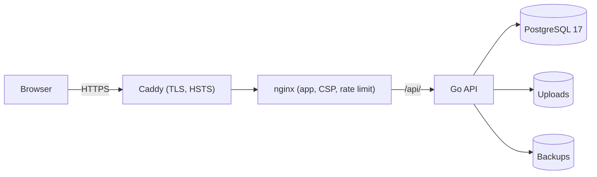

# Fly_Birds — Final Project Report

**Project:** Fly_Birds, a white-label school management system for Bangladesh
**Milestones:** M0 Foundation to M13 Final Release
**Report date:** 19 October 2026
**Author:** Rayhan

## 1. Summary

Fly_Birds is a web application that runs the daily work of a Bangladeshi
school: accounts and permissions, academic structure, students and guardians,
staff, attendance, routines, exams and results, fees and accounts, notices,
events, class diary, notifications, analytics, reports and administration.
It serves six roles (administrator, head teacher, teacher, accountant,
student and guardian) in Bangla and English, and each school runs its own
branded installation with its own database.

All 83 acceptance criteria in the [project brief](PROJECT_BRIEF.md) across
M0–M13 have repository evidence and local verification (see
[PROGRESS.md](PROGRESS.md)). The system is **release-ready as software**, but
a real school should not go live until the prerequisites in section 9 are
met, chiefly because online payment and SMS are simulations and password
recovery depends on a server operator.

## 2. Objectives and scope

The brief set out to build a reusable product that any school can adopt by
changing its name, logo, colours and enabled modules, without code changes.
Its non-negotiables were correctness, security, bilingual support and
milestone-by-milestone verification. Features listed as future work (online
admission, library, stipend management, assignment portal, chatbot and
machine-learning prediction) were deliberately not built.

| Milestone | Delivered |
|---|---|
| M0 Foundation | Go API and React app skeleton, PostgreSQL, Docker Compose, CI, health endpoint |
| M1 Authentication, RBAC, settings | Sign-in with rotating refresh tokens and CSRF protection, lockout, role permissions, permission editor, school branding and modules, user administration, audit log, role dashboards |
| M2 Academic structure | Sessions (one active), classes, sections, subjects, class-subject mapping |
| M3 Students and guardians | Admissions, roll numbers, photos, guardian links, CSV import, self and child views |
| M4 Teachers and staff | Staff profiles, assignments, leave, salary records |
| M5 Attendance | Student and teacher registers, corrections, QR check-in, monthly reports, absence alerts |
| M6 Routines | Class timetables with clash detection, exam routines |
| M7 Exams and results | Marks entry, Bangladesh GPA grading, positions, publication |
| M8 Fees and accounts | Categories, structures, dues, concessions, receipts, overdue tracking, ledger, simulated online payment |
| M9 Communication | Notices, events, class diary with homework submissions, in-app notifications, simulated SMS |
| M10 Admin control center | Overview, system health, exports, backups with verification and restore |
| M11 Analytics and reports | Attendance, results and fee analytics, rule-based at-risk and dropout alerts, CSV and printable reports |
| M12 UI and product polish | Role-aware shell, role dashboards, white-label theming, dark theme, empty and error states, idempotent demo seed |
| M13 Final release | Automated tests in CI, complete OpenAPI document, README with screenshots, ER, data flow and use case diagrams, deployment and operations guides, security hardening, this report |

## 3. Architecture and design

- **Backend:** Go 1.26 with Gin. Handlers validate input and call services;
  services hold business rules; repositories hold SQL. PostgreSQL 17 with 20
  embedded, versioned migrations applied at startup (latest `1201`), 61
  tables. One database holds exactly one school, so isolation between
  schools is physical, not a `school_id` filter.
- **Frontend:** React 19, TypeScript, Vite, Tailwind CSS, TanStack Query,
  react-router and i18next, with 1,716 translation keys in each language.
  Branding is applied at runtime through CSS tokens with contrast checks.
- **API:** 246 operations on 187 paths, documented in
  [OpenAPI 3](openapi.yaml) with 23 tags.
- **Diagrams:** [ER diagram](diagrams/er-diagram.md),
  [data flow diagram](diagrams/data-flow-diagram.md) and
  [use case diagram](diagrams/use-case-diagram.md).

Key design decisions:

- **One installation per school** keeps data separation simple and lets each
  school upgrade, back up and restore independently.
- **Permissions are data**, checked on every request, so a school can tune
  role rights without a release; every change is audited.
- **Modules** can be switched off per school, with dependencies enforced on
  the server and the navigation built from the same rules.
- **Analytics are computed from source records** on request, so figures are
  never stale; alerts are explainable rules rather than predictions.
- **Money is stored as exact decimals**; payments are idempotent and
  allocated to dues in a transaction.

## 4. Security

**Controls in place.**
- 15-minute HS256 access tokens; opaque refresh tokens rotated on every use
  and stored only as hashes; HttpOnly, Secure, SameSite=Strict cookies with
  a double-submit CSRF token.
- Account lockout after 5 failures for 15 minutes; login rate limit at the
  web server (30 per minute per address).
- Bcrypt password hashes; 12–72 byte passwords.
- Role permissions and module checks on every request; teacher, student and
  guardian scope enforced in SQL; denied requests audited.
- Upload validation by content (PDF and image), size limits, and storage
  outside the web root.
- CSV exports neutralise formula-like cells.
- Security headers on every API and web response; strict CSP; HSTS; servers
  hide their versions; database and API never published to the host.

**M13 review and fixes.** The M13 review re-checked M0–M12 for release
blockers. Sessions, token rotation, CSRF, RBAC and scope checks held up.
These issues were fixed, each with a regression check:

| Finding | Fix | Evidence |
|---|---|---|
| No way to recover an account (forgotten password or long lockout) and the login page implied a self-service reset | `reset-password` operator command: sets the password, clears lockout, revokes all sessions and audits; login help text corrected | `TestPostgresOperatorPasswordReset` |
| API responses carried no security headers | Middleware adds nosniff, frame denial, no-referrer, deny-all CSP and a same-origin resource policy | `TestSecurityHeadersOnEveryResponse` |
| Container health was liveness only; a lost database went unnoticed | `GET /readyz` pings PostgreSQL (503 without leaking the error); Docker health check uses it | `TestReadyzReportsDatabaseState` |
| Web server lacked CSP, Permissions-Policy and an upload limit, and duplicated headers on API responses | Hardened nginx configuration | Header and 413 checks on the production stack |
| Known vulnerabilities reachable in the Go standard library and `golang.org/x` modules | Go 1.26.9 toolchain and updated modules | `govulncheck`: none called |
| No production deployment configuration (plain HTTP, published database port) | Per-school production stack with a TLS edge | Production smoke test (section 6) |

## 5. Testing

| Layer | What | Result (19 October 2026) |
|---|---|---|
| Go unit and PostgreSQL integration tests | `go test ./... -p 1 -count=1` on a fresh PostgreSQL 17 database | 87 of 87 top-level tests and 17 of 17 subtests passed; 0 failed, 0 skipped; 20 packages with tests |
| Static checks | `gofmt`, `go vet`, `govulncheck` | Clean; no called vulnerabilities |
| API contract | Route coverage and completeness tests on the OpenAPI document | Passed (246 operations) |
| Frontend | TypeScript build, translation key check, `npm audit` | Passed; 1,716 keys each; 0 vulnerabilities |
| Browser, production stack over HTTPS | `e2e/suite.mjs` and `e2e/whitelabel.mjs` in headless Edge | 106 of 106 and 23 of 23 checks; no exceptions, no CSP violations |
| Compose and images | Development and production Compose validation; backend and web images built | Passed |
| Backup and restore | Backup, verify, checksum, refused overwrite, restore into an isolated database | Passed; row counts match |
| Upgrades | M10 schema to M13; copy of a real M12 database to M13 | Passed; existing data unchanged |
| Every commit on the M13 branch | Build, vet and unit tests at each commit | Passed |

Continuous integration (`.github/workflows/ci.yml`) runs all of the above
except the upgrade drills on every push and pull request. **The new workflow
has not yet run on GitHub**; it was validated locally only.

Not tested: load and performance at large-school scale, a full screen-reader
audit, real payment and SMS providers, and real-device testing beyond
browser emulation at 390, 820 and 1366 px.

## 6. Deployment and operations

- [DEPLOYMENT.md](DEPLOYMENT.md): server requirements, per-school
  environment files, HTTPS with Caddy or a shared proxy, upgrades and
  rollback.
- [OPERATIONS.md](OPERATIONS.md): first administrator, school setup, password
  resets, backups with encrypted off-site copies, restore drills, disaster
  recovery, troubleshooting, release validation and a go-live checklist.

The production stack was verified locally as an isolated Compose project with
`SCHOOL_DOMAIN=localhost`:

- HTTPS served with HSTS, CSP and Permissions-Policy; HTTP redirected
  (308); `/api/readyz` ready; backend running as uid 10001; database and API
  not published.
- A 9.5 MB PDF upload was accepted and a 13 MB upload refused (413). Of 70
  rapid login attempts, 29 were rate-limited (429).
- A backup of the demo school (60 tables, 2,727 rows, 1 file) verified, and
  its downloaded checksum matched. Restoring over the live database was
  refused. Restoring into an isolated database gave identical counts for
  users, students, results, attendance, payments, ledger, notices and files,
  and Bangla text intact. The documented restore-drill commands were then
  run as written and produced matching counts.

No real server, domain or school database was used.

## 7. Acceptance criteria — M13

| Criterion | Evidence |
|---|---|
| Automated testing | 87 Go tests and 17 subtests (unit and PostgreSQL integration), OpenAPI contract tests, browser suites (129 checks), CI workflow running tests, scans, image builds and browser suites |
| Complete Swagger documentation | [openapi.yaml](openapi.yaml): 246 operations, each with an operationId, summary, tag, success response and, where secured, 401 and 403; enforced by a test |
| Professional README with screenshots | [README](../README.md) with 8 screenshots from the demo school |
| ER diagram | [diagrams/er-diagram.md](diagrams/er-diagram.md), generated from the migrated schema's foreign keys |
| Data Flow Diagram | [diagrams/data-flow-diagram.md](diagrams/data-flow-diagram.md), context and level 1 |
| Use case diagram | [diagrams/use-case-diagram.md](diagrams/use-case-diagram.md), from the enforced permission matrix |
| Final project report | This document |

## 8. Limitations

- **Online payment (bKash, Nagad) is simulated.** No gateway contract or
  integration exists.
- **SMS is simulated.** No SMS gateway is integrated; in-app notifications
  are real.
- **No self-service password reset.** Signed-in users can change their own
  password on the account page; a forgotten password still needs the server
  operator (`reset-password`), because there is no email delivery.
- **No email delivery** of any kind.
- **Single school per installation**; several schools need several stacks.
- **Rule-based alerts**, not predictions; analytics checked on fixture-sized
  data only.
- **Reports** are CSV and print, not PDF or Excel files.
- **Accessibility**: automated basics and contrast checks only.

## 9. Before a real school goes live

1. Run the new CI workflow on GitHub and confirm it passes.
2. Merge the release, tag it, and deploy from the tag following
   [DEPLOYMENT.md](DEPLOYMENT.md) on a hardened server with a real domain.
3. Decide on payments: switch online payment off, or contract and integrate
   a real gateway (a new piece of work with its own security review).
4. Decide on SMS: accept in-app only, or integrate a real gateway.
5. Agree a password-recovery procedure with the school office (identity
   check, then `reset-password`) for forgotten passwords. Ask users to change
   any password the office issued from their account page.
6. Make sure no demo accounts exist in the school's database.
7. Turn on automatic backups, pass a restore drill and set up encrypted
   off-site copies.
8. Run a pilot with real staff for a few weeks, including a load check with
   the school's real size, before relying on the system for fees or results.
9. Agree data-protection responsibilities with the school (who may access
   children's data and backups, and for how long).

## 10. Future work

From the brief: online admission, library management, stipend management,
an assignment portal, a chatbot and machine-learning prediction. From this
release: forgotten-password recovery, real payment and SMS gateways,
email notifications, PDF report export and a full accessibility audit.
