# Fly_Birds ব্যবহার নির্দেশিকা

এই নির্দেশিকা বিদ্যালয়ের কর্মীদের জন্য: প্রশাসক (Admin), প্রধান শিক্ষক (Head Teacher), শিক্ষক (Teacher), হিসাবরক্ষক (Accountant), আর শিক্ষার্থী ও পরিবার। প্রত্যেকের জন্য আলাদা অধ্যায় আছে, তাই নিজের অধ্যায় আর "সবার জন্য" অংশটি পড়লেই চলবে। সার্ভার বসানো ও রক্ষণাবেক্ষণের কাজ [HOSTING_GUIDE.md](HOSTING_GUIDE.md)-এ আছে।

বোতাম আর মেনুর নাম এখানে **মোটা অক্ষরে** লেখা, ঠিক যেভাবে বাংলায় পর্দায় দেখা যায়। অনেক জায়গায় পাশে বন্ধনীতে ইংরেজি নামও দেওয়া আছে, যাতে ইংরেজিতে চালানো কেউ বা আইটি সহায়তাকারী সহজে খুঁজে পান। ছবিগুলো একটি ডেমো স্কুল (গ্রিন ভ্যালি ডেমো স্কুল) থেকে নেওয়া; আপনার স্কুলের নাম, রং ও তথ্য আলাদা হবে।

## সূচি

- [সবার জন্য: সাইন ইন, ভাষা ও পাসওয়ার্ড](#সবার-জন্য-সাইন-ইন-ভাষা-ও-পাসওয়ার্ড)
- [অধ্যায় ১: প্রশাসক (Admin)](#অধ্যায়-১-প্রশাসক-admin)
- [অধ্যায় ২: প্রধান শিক্ষক (Head Teacher)](#অধ্যায়-২-প্রধান-শিক্ষক-head-teacher)
- [অধ্যায় ৩: শিক্ষক (Teacher)](#অধ্যায়-৩-শিক্ষক-teacher)
- [অধ্যায় ৪: হিসাবরক্ষক (Accountant)](#অধ্যায়-৪-হিসাবরক্ষক-accountant)
- [অধ্যায় ৫: শিক্ষার্থী ও পরিবার (Student and Family)](#অধ্যায়-৫-শিক্ষার্থী-ও-পরিবার-student-and-family)
- [যা এখনো নেই](#যা-এখনো-নেই)

---

## সবার জন্য: সাইন ইন, ভাষা ও পাসওয়ার্ড

### সাইন ইন (Sign in)

স্কুলের ঠিকানা (যেমন `https://school.greenvalley.edu.bd`) খুললে প্রথমেই সাইন-ইন ফর্ম পাবেন। তার নিচে স্কুলের পাবলিক পাতা থাকে (পরিচিতি, প্রধান শিক্ষকের বাণী, ছবি, নোটিশ, যোগাযোগ)।

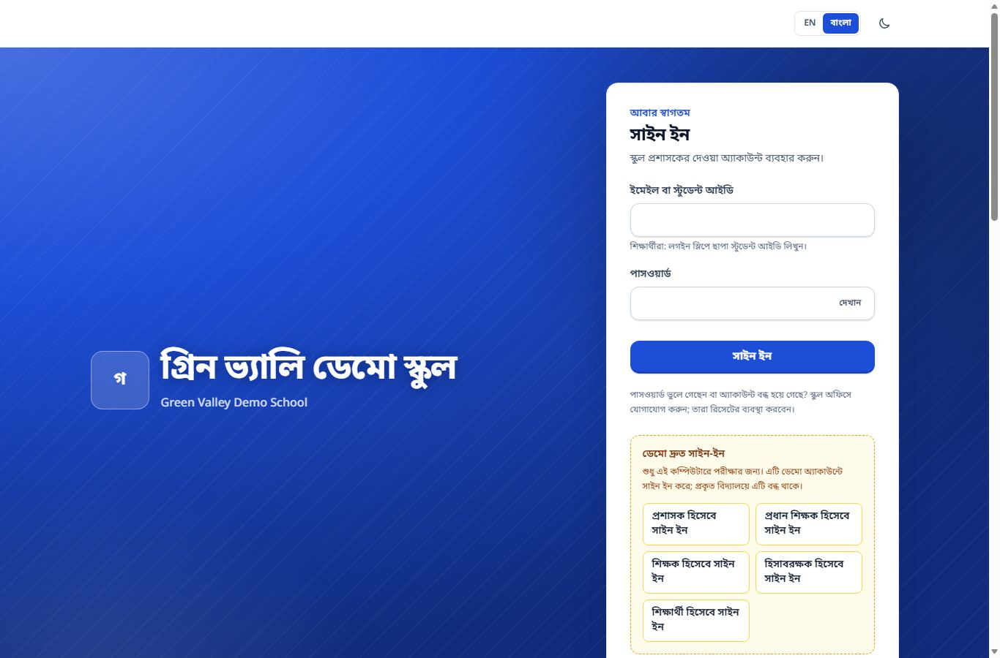

- **ইমেইল বা স্টুডেন্ট আইডি (Email or Student ID):**
  - কর্মীরা নিজের ইমেইল দিয়ে সাইন ইন করেন।
  - শিক্ষার্থীরা লগইন স্লিপে ছাপা **সাইন-ইন আইডি (Sign-in ID)** দেন। এটি সাধারণত স্টুডেন্ট আইডি, না থাকলে ভর্তি নম্বর। বড় বা ছোট হাতের অক্ষরে কোনো পার্থক্য হয় না।
- **প্রথমবার সাইন ইন:** বিদ্যালয়ের দেওয়া অস্থায়ী পাসওয়ার্ড (Temporary password) দিয়ে ঢুকলে **নিজের পাসওয়ার্ড বেছে নিন** পাতা আসে। নতুন পাসওয়ার্ড দেওয়ার আগে অন্য কিছু খোলা যায় না।
- **ভুল পাসওয়ার্ড:** পরপর ৫ বার ভুল দিলে অ্যাকাউন্ট ১৫ মিনিটের জন্য বন্ধ থাকে। অপেক্ষা করুন, অথবা প্রশাসককে পাসওয়ার্ড রিসেট করতে বলুন।
- **পাসওয়ার্ড ভুলে গেলে:** নিজে রিসেট করার ব্যবস্থা নেই। বিদ্যালয়ের অফিসে যোগাযোগ করুন; প্রশাসক রিসেট করে নতুন স্লিপ দেবেন।

### ভাষা, থিম ও ফোন

- ওপরের ডান দিকে **EN / বাংলা** বোতামে ভাষা বদলায়। চাঁদের চিহ্নে ডার্ক থিম (Dark theme) চালু বা বন্ধ হয়।
- ফোনে বাঁ দিকের **মেনু খুলুন** বোতামে পুরো মেনু আসে, আর নিচের সারিতে প্রধান কাজগুলো থাকে।
- আপনি যা করার অনুমতি পেয়েছেন, মেনুতে শুধু সেগুলোই দেখা যায়। কোনো পাতা না পেলে প্রশাসককে জিজ্ঞেস করুন।

### নিজের পাসওয়ার্ড বদলানো

ওপরের ডান দিকে নিজের নামে চাপুন, তারপর **অ্যাকাউন্ট** খুলুন। **পাসওয়ার্ড ও সাইন ইন** অংশে বর্তমান পাসওয়ার্ড আর দুবার নতুন পাসওয়ার্ড দিয়ে **পাসওয়ার্ড বদলান** চাপুন। পাসওয়ার্ড ১২ থেকে ৭২ অক্ষরের হতে হবে। বদলালে অন্য সব ডিভাইস থেকে আপনি সাইন আউট হয়ে যাবেন, তবে এই ডিভাইসে সাইন ইন থাকবেন।

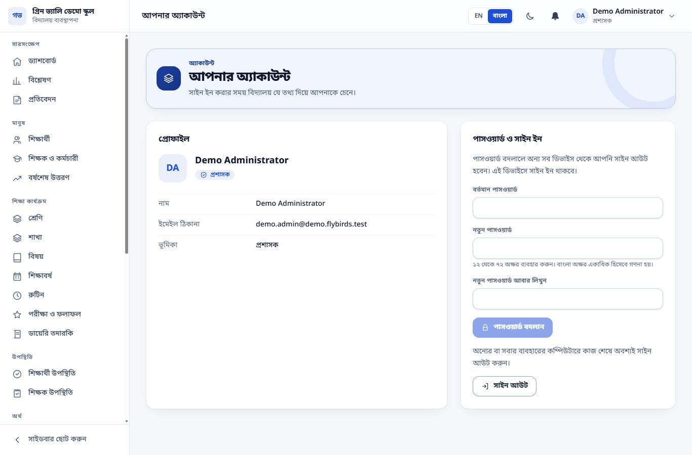

### অস্থায়ী পাসওয়ার্ডের মেয়াদ (১৪ দিন)

বিদ্যালয় যেকোনো পাসওয়ার্ড দিলে, যেমন ভর্তির সময়, লগইন তৈরির সময় বা রিসেটের সময়, তা **দেওয়ার ১৪ দিন পর বাতিল হয়ে যায়**, যদি এর মধ্যে নিজের পাসওয়ার্ড বেছে নেওয়া না হয়।

- শেষ তারিখটি স্লিপে **এই পাসওয়ার্ড ব্যবহারের শেষ তারিখ** (Use this password by) হিসেবে ছাপা থাকে।
- মেয়াদ পার হলে সাইন-ইনের সময় লেখা আসে "এই অস্থায়ী পাসওয়ার্ডের মেয়াদ শেষ হয়ে গেছে।" তখন অফিস থেকে নতুন পাসওয়ার্ড নিতে হবে (অধ্যায় ১.৬)।
- একবার নিজের পাসওয়ার্ড বেছে নিলে আর কোনো মেয়াদ থাকে না।

---

## অধ্যায় ১: প্রশাসক (Admin)

প্রশাসক স্কুলের সব সেটিংস, ব্যবহারকারী, ভর্তি, পরীক্ষা প্রকাশ, বর্ষশেষ উত্তরণ ও ব্যাকআপ দেখেন। প্রথম প্রশাসক অ্যাকাউন্টটি সার্ভার পরিচালক তৈরি করেন ([HOSTING_GUIDE.md §6](HOSTING_GUIDE.md#6-the-first-administrator))। বাকি সব অ্যাকাউন্ট অ্যাপ থেকেই তৈরি হয়।

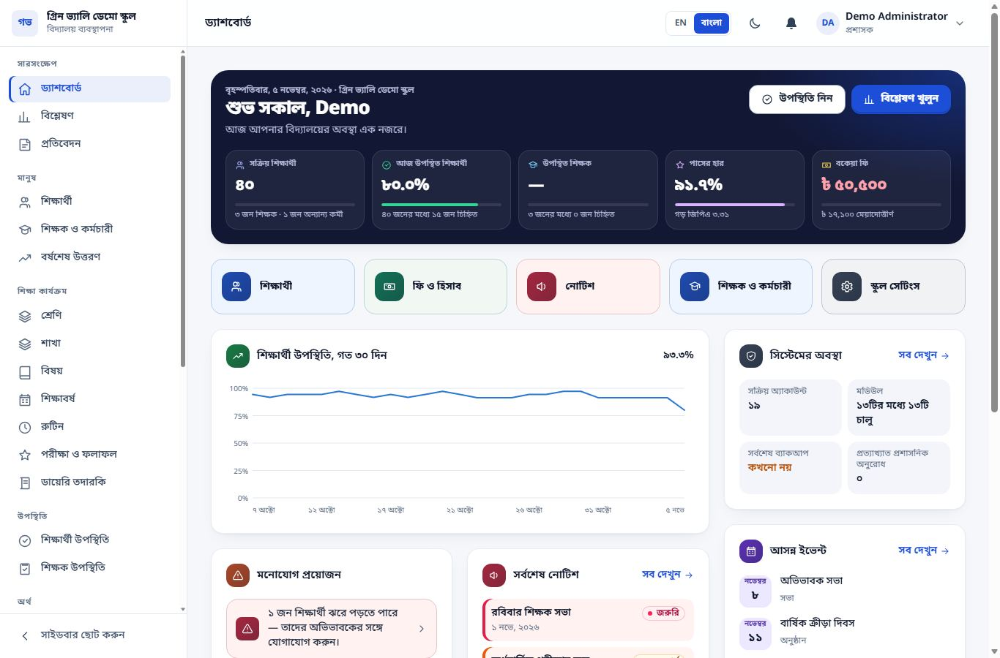

### ১.১ প্রথমবার সেটআপ

এই ক্রমেই করুন, কারণ পরের ধাপগুলো আগের ধাপের ওপর নির্ভর করে।

1. **প্রশাসন → স্কুল সেটিংস:** স্কুলের নাম, লোগো, রং ও গ্রেডিং পদ্ধতি দিন (১.২)।
2. **প্রশাসন → মডিউল (Modules):** স্কুল যে মডিউলগুলো ব্যবহার করবে সেগুলো চালু করুন। কিছু মডিউল অন্যটির ওপর নির্ভর করে; যেমন উপস্থিতি চালু করতে শিক্ষার্থী ও কর্মচারী মডিউল লাগে।
3. **প্রশাসন → অনুমতি (Permissions):** কোন ভূমিকা (Role) কী করতে পারবে তার তালিকা। সাধারণত যেমন আছে তেমনই রাখা ভালো। প্রতিটি পরিবর্তন অডিট লগে লেখা থাকে।
4. **শিক্ষা কার্যক্রম → শিক্ষাবর্ষ:** শিক্ষাবর্ষ তৈরি করুন (যেমন "2027", ১ জানুয়ারি থেকে ৩১ ডিসেম্বর) এবং সক্রিয় করুন। একসাথে একটিই সক্রিয় থাকে।
5. **শ্রেণি**, তারপর **বিষয়**। প্রতিটি শ্রেণির বিষয় ঠিক করুন এবং প্রযোজ্য হলে চতুর্থ বিষয় চিহ্নিত করুন। তারপর সক্রিয় শিক্ষাবর্ষে প্রতিটি শ্রেণির **শাখা** তৈরি করুন।
6. **শিক্ষক ও কর্মচারী:**
   - **প্রশাসন → ব্যবহারকারী → ব্যবহারকারী তৈরি করুন** দিয়ে প্রতিটি শিক্ষক, প্রধান শিক্ষক ও হিসাবরক্ষকের অ্যাকাউন্ট খুলুন।
   - তারপর **মানুষ → শিক্ষক ও কর্মচারী** পাতায় প্রোফাইল তৈরি করে অ্যাকাউন্টের সঙ্গে যুক্ত করুন, এবং শ্রেণি ও বিষয় দিন।
7. **শিক্ষার্থী ভর্তি:** একজন করে (১.৩) বা স্প্রেডশিট থেকে একসাথে (১.৪)।
8. স্কুল ব্যবহার শুরু করলে **রুটিন**, **ফি নির্ধারণ** (অধ্যায় ৪) ও **পরীক্ষা** (১.৮) ঠিক করুন।

### ১.২ স্কুলের তথ্য ও পাবলিক পাতা

**প্রশাসন → স্কুল সেটিংস** পাতায় দুটি অংশ আছে।

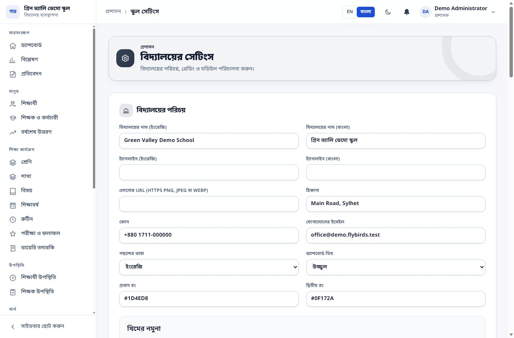

**বিদ্যালয়ের পরিচয়:**
- স্কুলের নাম (ইংরেজি ও বাংলা), ঠিকানা, ফোন, ইমেইল এবং লোগোর লিংক (HTTPS)।
- প্রধান ও সহায়ক রং। সাদা পটভূমিতে পড়া কঠিন হয় এমন রং গ্রহণ করা হয় না।
- পছন্দের ভাষা, নামের নিচের ছোট বাক্য (Tagline) এবং গ্রেডিং পদ্ধতি।

শেষে **পরিচয় সংরক্ষণ** চাপুন।

**বিদ্যালয়ের পাবলিক পাতা** (Public school page) সাইন-ইন ফর্মের নিচে সবাই দেখতে পায়। প্রতিটি অংশ ইংরেজি ও বাংলায় লিখুন; খালি রাখা অংশ দেখানো হয় না।

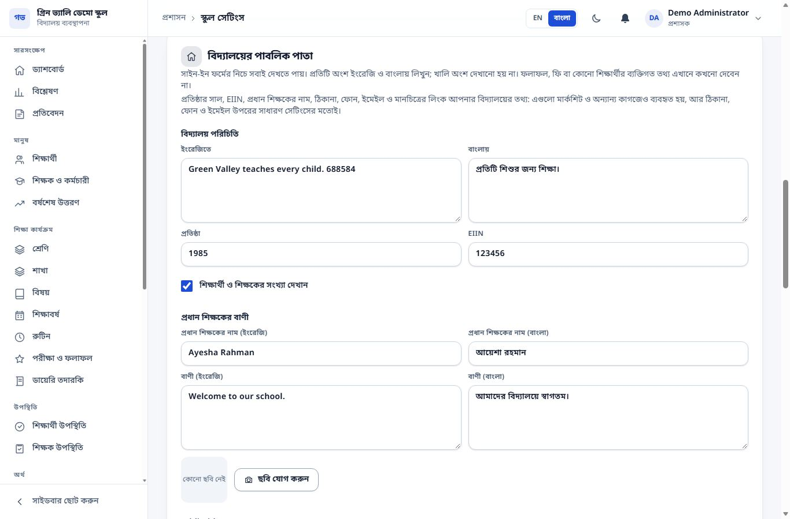

- **পরিচিতি:** স্কুলের বর্ণনা, প্রতিষ্ঠার সাল, **EIIN** (৬ অঙ্ক), আর চাইলে সক্রিয় শিক্ষার্থী ও শিক্ষকের মোট সংখ্যা।
- **প্রধান শিক্ষকের বাণী:** নাম, বাণী ও ছবি।
- **যোগাযোগ:** ঠিকানা (ইংরেজি ও বাংলা), ফোন, ইমেইল এবং মানচিত্রের লিংক (https)। পাতায় মানচিত্র বসানো হয় না, শুধু লিংক দেখায়।
- **গ্যালারি:** সর্বোচ্চ ৪৮টি ছবি। যোগ করার সময় ছবি ছোট ও হালকা করা হয়।

শেষে **পাবলিক পাতা সংরক্ষণ করুন** চাপুন।

গুরুত্বপূর্ণ:

- **এগুলো স্কুলের নিজস্ব তথ্য।** প্রতিষ্ঠার সাল, EIIN, প্রধান শিক্ষকের নাম, ঠিকানা, ফোন, ইমেইল ও মানচিত্রের লিংক মার্কশিট ও অন্যান্য কাগজেও ব্যবহারের জন্য রাখা হয়। ঠিকানা, ফোন ও ইমেইল ওপরের "বিদ্যালয়ের পরিচয়" অংশের সঙ্গে একই; এক জায়গায় বদলালে অন্য জায়গাতেও বদলায়।
- **শিশুদের ছবির আগে অনুমতি নিন।** যে ছবিতে কোনো শিশুকে চেনা যায়, প্রকাশের আগে অভিভাবকের অনুমতি নিন, আর ক্যাপশনে কখনো শিশুর নাম লিখবেন না।
- **পাবলিক পাতায় নোটিশ:** নতুন নোটিশ লেখার সময় **বিদ্যালয়ের পাবলিক পাতায় দেখান** টিক দিলে, প্রকাশের পর নোটিশটি এখানে দেখা যাবে। এটি নিজে থেকে বন্ধ থাকে।
- **ব্যক্তিগত তথ্য কখনো নয়।** ফলাফল, ফি বা কোনো শিক্ষার্থীর ব্যক্তিগত তথ্য পাবলিক পাতায় দেবেন না।

### ১.৩ শিক্ষার্থী ভর্তি (একজন করে)

**মানুষ → শিক্ষার্থী → শিক্ষার্থী ভর্তি** (Admit a student)। এক পাতাতেই চারটি অংশ:

1. **শিক্ষার্থী:** নাম (ইংরেজি ও বাংলা), জন্মতারিখ ইত্যাদি।
2. **শ্রেণি ও রোল:** শেষবার যে শ্রেণি ও শাখা ব্যবহার হয়েছিল তা আগে থেকে বাছাই থাকে, আর পরের খালি রোল নম্বর প্রস্তাব করা হয়।
3. **অভিভাবক:** দুজন পর্যন্ত। কোনো অভিভাবকের ফোন বা ইমেইল আগে থেকেই থাকলে "আগে থেকেই আছে। ইনি কি একই ব্যক্তি?" দেখায়। একই ব্যক্তি হলে **এই অভিভাবক ব্যবহার করুন** চাপুন, যাতে একজন অভিভাবকের দুটি রেকর্ড না হয়।
4. **শিক্ষার্থীর লগইন:** চাইলে **শিক্ষার্থীর জন্য লগইন তৈরি করুন** টিক দিন।

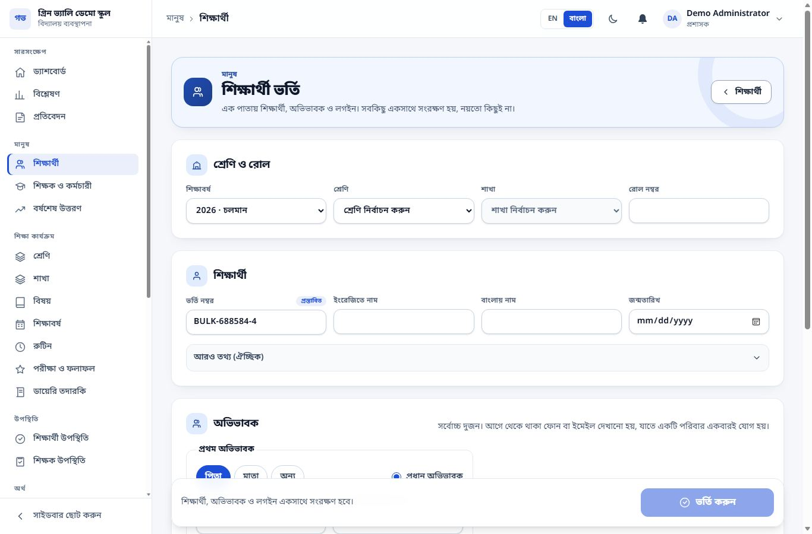

**ভর্তি করুন** চাপলে সব একসাথে সংরক্ষণ হয়, নয়তো কিছুই না; মাঝপথে আধা-ভর্তি কিছু থেকে যায় না। তারপর **ভর্তি স্লিপ প্রিন্ট করুন**। লগইন তৈরি হলে স্লিপে সাইন-ইন আইডি, অস্থায়ী পাসওয়ার্ড ও তার শেষ তারিখ থাকে। পাসওয়ার্ড শুধু এই একবারই দেখানো হয়।

### ১.৪ স্প্রেডশিট থেকে ভর্তি (Bulk admission)

**মানুষ → শিক্ষার্থী → স্প্রেডশিট থেকে ভর্তি** দিয়ে একসাথে সর্বোচ্চ ১,০০০ জন (৪ এমবি পর্যন্ত ফাইল) ভর্তি করা যায়।

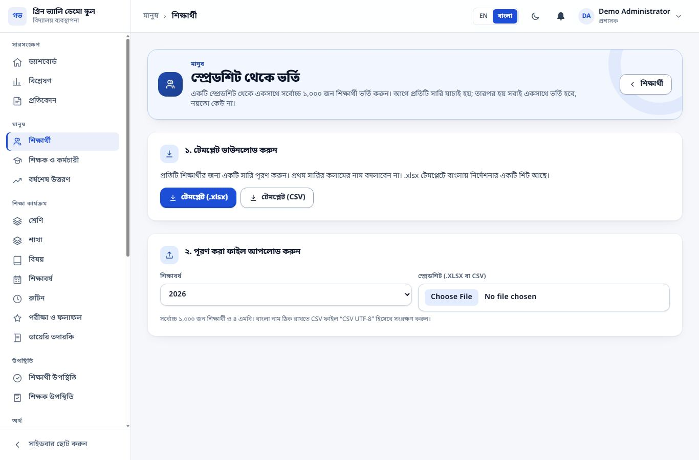

1. **টেমপ্লেট ডাউনলোড করুন:** .xlsx (এতে বাংলায় নির্দেশনার একটি শিট আছে) অথবা CSV। প্রতিটি শিক্ষার্থীর জন্য একটি সারি পূরণ করুন, আর প্রথম সারির কলামের নাম বদলাবেন না। CSV ব্যবহার করলে বাংলা নাম ঠিক রাখতে ফাইলটি "CSV UTF-8" হিসেবে সংরক্ষণ করুন।
2. **পূরণ করা ফাইল আপলোড করুন।** প্রতিটি সারি তখনই যাচাই হয়; এ সময় কিছুই সংরক্ষণ হয় না।
3. **সারিগুলো দেখে নিন।** সমস্যার সারি লাল দেখায়, আর **শুধু সমস্যার সারি দেখান** দিয়ে শুধু সেগুলো দেখা যায়। স্প্রেডশিটে ঠিক করে আবার আপলোড করুন।
4. সব ঠিক থাকলে চাইলে **প্রত্যেক নতুন শিক্ষার্থীর লগইনও তৈরি করুন** টিক দিন, তারপর **N জন শিক্ষার্থী ভর্তি করুন** চাপুন। হয় সবাই একসাথে ভর্তি হবে, নয়তো কেউ না।

যা জেনে রাখা ভালো:

- **অভিভাবক:** ফোন বা ইমেইল মিললে আগের অভিভাবক যুক্ত হয়। একই ফাইলের ভাইবোনেরা একজন নতুন অভিভাবক পায়।
- **আবার আপলোড:** একই ফাইল আবার আপলোড করলে আগে ভর্তি হওয়াদের বাদ দেওয়া হয়, কেউ দুবার ভর্তি হয় না।
- **স্লিপ:** লগইন তৈরি হলে এখানেই সবার স্লিপ প্রিন্ট করুন (১.৫)।

### ১.৫ লগইন ও লগইন স্লিপ

শিক্ষার্থীর লগইন তিনভাবে তৈরি করা যায়:

- ভর্তির সময় (১.৩, ১.৪)।
- **একজনের জন্য:** শিক্ষার্থীর প্রোফাইল খুলে **লগইন তৈরি করুন**।
- **পুরো শাখার জন্য:** **মানুষ → শিক্ষার্থী → শিক্ষার্থীর লগইন**। **শাখা বাছাই করুন**, তারপর **যাদের লগইন নেই, সবাইকে লগইন দিন**।

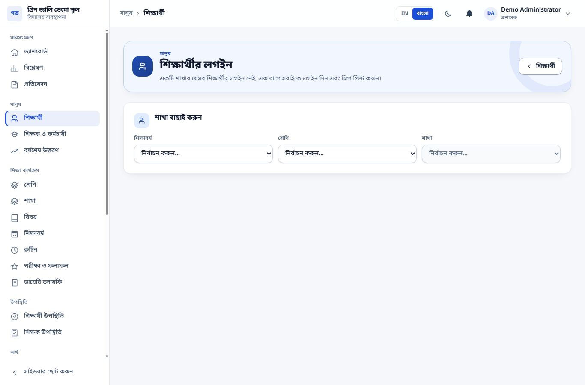

প্রতিটি স্লিপে ইংরেজি ও বাংলা দুই ভাষায় লেখা থাকে:

- শিক্ষার্থীর নাম, শ্রেণি, শাখা ও রোল;
- **সাইন-ইন আইডি** ও **অস্থায়ী পাসওয়ার্ড**;
- **এই পাসওয়ার্ড ব্যবহারের শেষ তারিখ** (দেওয়ার দিন থেকে ১৪ দিন);
- কীভাবে প্রথমবার সাইন ইন করতে হয়।

শাখার স্লিপ A4 কাগজে পাশাপাশি দুটি করে, এক পাতায় আটটি ছাপা হয়।

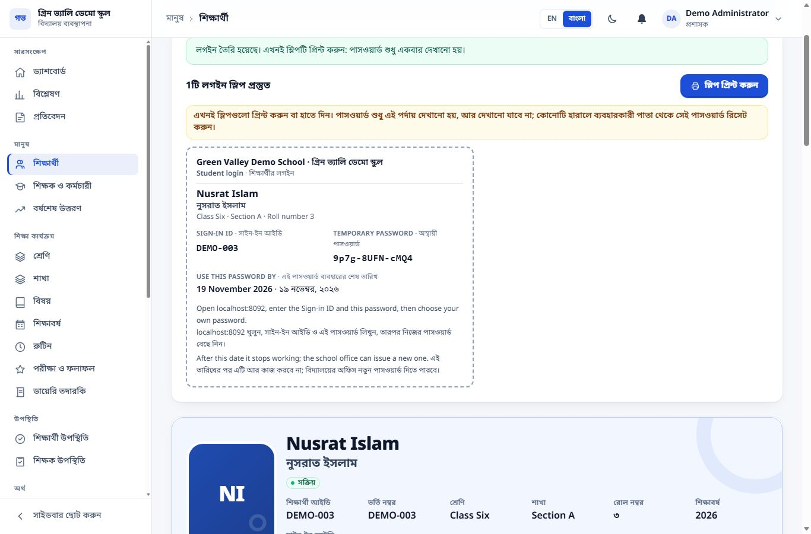

- **পাসওয়ার্ড শুধু একবার দেখানো হয়।** এখনই প্রিন্ট করুন বা হাতে দিন; পরে আর দেখা যাবে না, আর কোথাও লেখা থাকে না।
- **স্লিপ হারালে বা মেয়াদ পার হলে** সেই শিক্ষার্থীর পাসওয়ার্ড রিসেট করুন (১.৬)। নতুন স্লিপে আবার ১৪ দিন সময় থাকে।
- **পরিবার আলাদা লগইন পায় না।** পরিবার শিক্ষার্থীর লগইন দিয়েই ঢোকে (অধ্যায় ৫)।

### ১.৬ ব্যবহারকারী ও পাসওয়ার্ড রিসেট

**প্রশাসন → ব্যবহারকারী** পাতায় সব অ্যাকাউন্ট দেখা যায়। নাম, ইমেইল বা সাইন-ইন আইডি দিয়ে খুঁজুন, তারপর অ্যাকাউন্টটি বাছাই করুন।

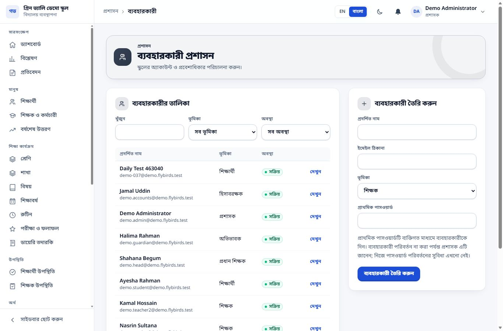

- **নতুন অ্যাকাউন্ট:** **ব্যবহারকারী তৈরি করুন** (কর্মীদের জন্য)।
- **পাসওয়ার্ড রিসেট:**
  - অ্যাকাউন্ট বাছাই করে **পাসওয়ার্ড রিসেট** চাপুন এবং নিশ্চিত করুন।
  - একটি নতুন অস্থায়ী পাসওয়ার্ডসহ স্লিপ আসে, ১৪ দিনের মেয়াদ সহ। স্লিপটি প্রিন্ট করে ব্যক্তিগতভাবে দিন।
  - ব্যবহারকারী সব ডিভাইস থেকে সাইন আউট হয়ে যান, আর পরের সাইন-ইনে নিজের পাসওয়ার্ড বেছে নেন।
  - রিসেট অডিট লগে লেখা থাকে, তবে পাসওয়ার্ডটি কোথাও লেখা থাকে না।
- **নিজের অ্যাকাউন্ট রিসেট করা যায় না।** অন্য একজন প্রশাসক লাগবে, অথবা নিজের পাসওয়ার্ড **অ্যাকাউন্ট** পাতা থেকে বদলান।
- **কেউ চলে গেলে** অ্যাকাউন্ট নিষ্ক্রিয় (Deactivate) করুন; তাঁর সব সেশন বন্ধ হয়ে যায়। শিক্ষার্থী প্রত্যাহার বা বদলি হলে তার লগইন নিজে থেকেই বন্ধ হয়।

### ১.৭ উপস্থিতি

- **উপস্থিতি → শিক্ষার্থী উপস্থিতি:** শ্রেণি, শাখা ও তারিখ বেছে হাজিরা খাতা খুলুন। **সবাইকে উপস্থিত দিন** দিয়ে শুরু করে প্রয়োজনমতো বদলান, তারপর **উপস্থিতি সংরক্ষণ** চাপুন। ফোনে **দ্রুত হাজিরা** আরও সহজ (অধ্যায় ৩.১)।
- **উপস্থিতি → শিক্ষক উপস্থিতি:** শিক্ষকদের দৈনিক হাজিরা।
- মাসিক হিসাব আর অনুপস্থিতির সতর্কতা পাওয়া যায় **বিশ্লেষণ** ও **প্রতিবেদন** পাতায়।

### ১.৮ পরীক্ষা ও ফলাফল

**শিক্ষা কার্যক্রম → পরীক্ষা ও ফলাফল।**

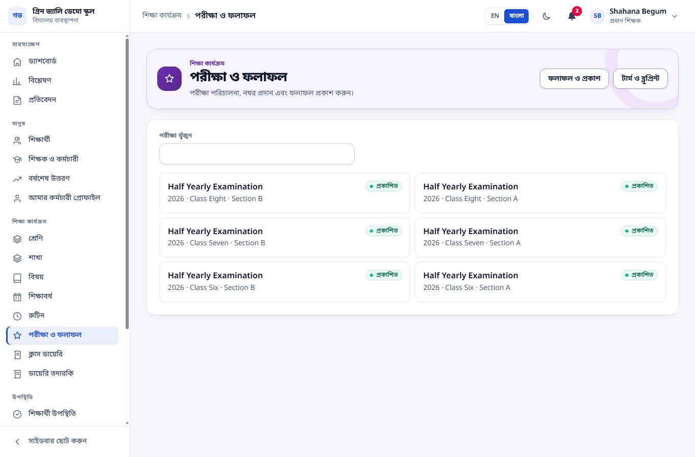

1. **টার্ম ও ব্লুপ্রিন্ট (Terms & blueprints):** বছরের টার্মগুলো (যেমন প্রথম সাময়িক, অর্ধবার্ষিক, বার্ষিক) এবং প্রতিটি শ্রেণির নম্বর বণ্টন ঠিক করুন:
   - ক্লাস টেস্ট;
   - CQ ও MCQ;
   - বাংলা ১ম ও ২য় পত্র একসাথে ধরা;
   - চতুর্থ বিষয়।

   যাচাই পরিষ্কার হলে **সক্রিয় করুন**। তারপর টার্মের পাতায় নম্বর জমার শেষ তারিখ দিয়ে **টার্ম তৈরি করুন**; সব পরীক্ষা ও নম্বরপত্র একসাথে তৈরি হয়। একটি আলাদা পরীক্ষার জন্য **নতুন পরীক্ষা**।
2. **নম্বর প্রদান:** শিক্ষকেরা নিজের নম্বরপত্রে নম্বর দেন এবং **পর্যালোচনার জন্য জমা দিন** চাপেন (অধ্যায় ৩.২)।
3. **অনুমোদন:** প্রধান শিক্ষক জমা দেওয়া নম্বরপত্র অনুমোদন করেন, অথবা কারণ লিখে ফেরত পাঠান (অধ্যায় ২)।
4. **প্রকাশ:** সব নম্বরপত্র অনুমোদিত হলে পরীক্ষার পাতায় **ফলাফল প্রকাশ** চাপুন। কোনো নম্বর বাকি বা অসম্পূর্ণ থাকলে প্রকাশ হয় না; পাতায় কী বাকি তা দেখায়।
5. **টার্ম ও বার্ষিক ফলাফল:** **ফলাফল ও প্রকাশ** পাতায় প্রধান শিক্ষক **এই ফলাফল অনুমোদন করুন** দেন, তারপর প্রশাসক **ফলাফল প্রকাশ** করেন।
6. **সংশোধন:** প্রকাশিত ফলাফল মুছে ফেলা হয় না। পরীক্ষার পাতার **সংশোধন** (Corrections) অংশে শিক্ষার্থী বেছে কারণ লিখে **সংশোধন খুলুন**। প্রধান শিক্ষকের অনুমোদনের পর তা নতুন সংস্করণ হিসেবে প্রকাশ হয়। আগের সংস্করণগুলো কর্মীরা দেখতে পারেন।
7. **ছাড় ও স্থগিত:** শুধু প্রশাসক কোনো শিক্ষার্থীকে কোনো বিষয় থেকে অব্যাহতি (Exempt) দিতে বা ফলাফল স্থগিত (Withhold) রাখতে পারেন, কারণ লিখে।

**ফলাফল পত্র ও PDF:**
- শিক্ষার্থী ও পরিবার **আমার ফলাফল** থেকে প্রকাশিত ফলাফল পত্র (Report card) দেখে এবং **ফলাফল পত্র প্রিন্ট** করতে পারে।
- PDF লাগলে প্রিন্টের ঘরে "Save as PDF" বেছে নিন।
- এই সংস্করণে সার্ভার থেকে আলাদা ফলাফল PDF ফাইল তৈরি হয় না।

### ১.৯ বর্ষশেষ উত্তরণ (Year-end promotion)

**মানুষ → বর্ষশেষ উত্তরণ।** বার্ষিক ফলাফল প্রকাশের পর শিক্ষার্থীদের পরের বছরের শ্রেণিতে তোলা হয় এখানে।

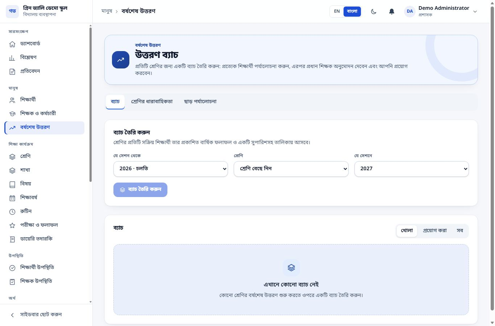

1. **প্রস্তুতি:**
   - পরের বছরের শিক্ষাবর্ষ ও শাখাগুলো আগে তৈরি করুন।
   - **শ্রেণির ধারাবাহিকতা** ট্যাবে প্রতিটি শ্রেণির পরের শ্রেণি, বা শেষ শ্রেণি, ঠিক করে **সংরক্ষণ** করুন।
2. **ব্যাচ তৈরি:** **ব্যাচ** ট্যাবে "যে সেশন থেকে", "শ্রেণি" আর "যে সেশনে" বেছে **ব্যাচ তৈরি করুন**। শ্রেণির প্রতিটি সক্রিয় শিক্ষার্থী তার প্রকাশিত বার্ষিক ফলাফল আর একটি সুপারিশসহ তালিকায় আসে।
3. **পর্যালোচনা:** প্রত্যেক শিক্ষার্থীর সিদ্ধান্ত দেখুন: উত্তীর্ণ, একই শ্রেণিতে থাকা, পাস করে বের হওয়া, প্রত্যাহার বা বদলি। সুপারিশ থেকে আলাদা সিদ্ধান্ত নিলে কারণ লিখতে হয়। নতুন শাখা ও রোল নম্বরও এখানে ঠিক হয়।
4. **অনুমোদন:** প্রধান শিক্ষক ঠিক কী অনুমোদন করছেন তা দেখে **অনুমোদন দিন** চাপেন।
5. **প্রয়োগ:** প্রশাসক **উত্তরণ প্রয়োগ করুন…** খুলে সংখ্যাগুলো দেখে **এখনই প্রয়োগ করুন** চাপেন।
   - সবাই একবারে নতুন বছরে যায়।
   - পুরোনো বছরের নম্বর, ফলাফল ও রিপোর্ট কার্ড যেমন ছিল তেমনই থাকে।
   - বের হয়ে যাওয়া শিক্ষার্থীদের লগইন বন্ধ হয়।
6. **ফিরিয়ে নেওয়া:** নতুন বছরে এই শিক্ষার্থীদের কিছু রেকর্ড না হওয়া পর্যন্ত কারণ লিখে **উত্তরণ ফিরিয়ে নিন** করা যায়। আর সম্ভব না হলে পাতায় কারণ দেখায়।

**ছাড় পর্যালোচনা** ট্যাবে আগের বছরের ফি ছাড় নতুন বছরে ঠিক করা আছে কি না দেখা যায়। এটি শুধু ফি দেখার অনুমতি থাকলে দেখা যায়।

### ১.১০ ব্যাকআপ (Backup)

**প্রশাসন → ব্যাকআপ।** একটি ব্যাকআপে পুরো ডেটাবেস (সাইন-ইন সেশন ছাড়া) আর আপলোড করা সব ফাইল থাকে, চেকসামসহ একটি আর্কাইভে।

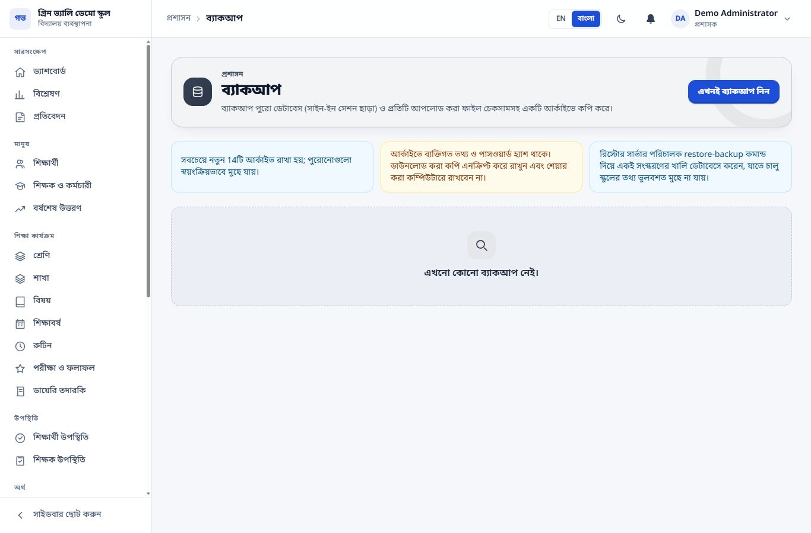

- **এখনই ব্যাকআপ নিন:** যেকোনো সময় হাতে ব্যাকআপ নিতে। যেকোনো বড় পরিবর্তন বা আপডেটের আগে অবশ্যই নিন।
- **যাচাই (Verify):** আর্কাইভটি ঠিক আছে কি না পরীক্ষা করে।
- **ডাউনলোড:** আর্কাইভ নিজের কম্পিউটারে নামায়।
- **স্বয়ংক্রিয় ব্যাকআপ:** সার্ভারে দৈনিক ব্যাকআপ চালু থাকে, আর সবচেয়ে নতুন কয়েকটি আর্কাইভ রাখা হয় (সংখ্যাটি পাতায় লেখা থাকে)। সার্ভারের বাইরে এনক্রিপ্ট করা কপি পাঠানোর কাজ সার্ভার পরিচালক করেন ([HOSTING_GUIDE.md §7](HOSTING_GUIDE.md#7-daily-backups-with-an-encrypted-off-server-copy))।
- **রিস্টোর (Restore)** অ্যাপ থেকে হয় না। সার্ভার পরিচালক তা একটি খালি ডেটাবেসে করেন, যাতে চালু স্কুলের তথ্য ভুলবশত মুছে না যায়।

আর্কাইভে শিশুদের ব্যক্তিগত তথ্য ও পাসওয়ার্ড হ্যাশ থাকে। ডাউনলোড করা কপি এনক্রিপ্ট করে রাখুন, শেয়ার করা কম্পিউটারে রাখবেন না।

### ১.১১ অন্যান্য প্রশাসনিক পাতা

- **কন্ট্রোল সেন্টার:** স্কুলের সংক্ষিপ্ত চিত্র।
- **অডিট লগ (Audit log):** কে কখন কী বদলেছেন।
- **ডেটা এক্সপোর্ট:** তালিকা CSV হিসেবে নামানো।
- **বার্তা প্রেরণ:** বিজ্ঞপ্তি পাঠানোর অবস্থা।
- **পরিচয়পত্র প্রিন্ট:** শিক্ষার্থী পাতা থেকে QR কোডসহ আইডি কার্ড প্রিন্ট করা যায়।

---

## অধ্যায় ২: প্রধান শিক্ষক (Head Teacher)

প্রধান শিক্ষক শিক্ষার্থীদের তথ্য দেখেন (বদলাতে পারেন না), উপস্থিতি নেন ও দেখেন, পরীক্ষার নম্বর ও ফলাফল অনুমোদন করেন, বর্ষশেষ উত্তরণ অনুমোদন করেন, আর নোটিশ ও ইভেন্ট দেন।

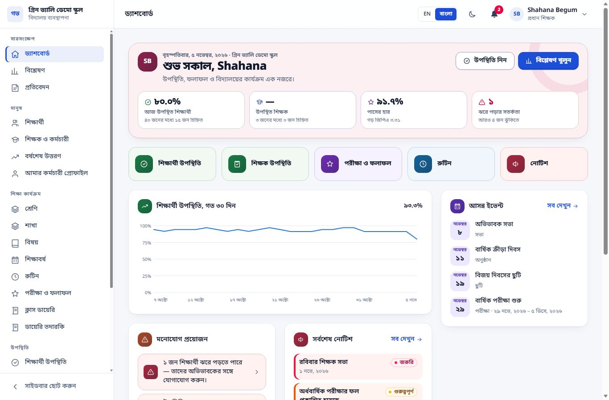

- **শিক্ষার্থী:** **মানুষ → শিক্ষার্থী** পাতায় প্রোফাইল, উপস্থিতি, ফলাফল ও শিক্ষাবর্ষের ইতিহাস দেখা যায়। ভর্তি ও লগইন তৈরি প্রশাসক করেন।
- **উপস্থিতি:**
  - **শিক্ষার্থী উপস্থিতি** ও **শিক্ষক উপস্থিতি** নেওয়া ও সংশোধন করা যায় (অধ্যায় ১.৭)।
  - মাসিক প্রতিবেদন **প্রতিবেদন** পাতায়।
- **নম্বরপত্র অনুমোদন:**
  - **পরীক্ষা ও ফলাফল** থেকে পরীক্ষা খুলুন। নম্বরপত্রের তালিকায় জমা দেওয়া পত্রের **নম্বরপত্র খুলুন** চাপুন।
  - ঠিক থাকলে **অনুমোদন করুন**, না হলে কারণ লিখে ফেরত পাঠান; শিক্ষক কারণটি দেখতে পান।
- **টার্ম ও বার্ষিক ফলাফল:** **ফলাফল ও প্রকাশ** পাতায় "পর্যালোচনার জন্য প্রস্তুত" শ্রেণি খুলে টেবুলেশন দেখুন, তারপর **এই ফলাফল অনুমোদন করুন**। অনুমোদনের পর নম্বর বদলালে আবার অনুমোদন লাগে। প্রকাশ প্রশাসক করেন।
- **ফলাফলের সংশোধন:** প্রশাসক সংশোধন খুললে তা অনুমোদন করাও আপনার কাজ (অধ্যায় ১.৮)।
- **বর্ষশেষ উত্তরণ:** **মানুষ → বর্ষশেষ উত্তরণ** পাতায় অপেক্ষমাণ ব্যাচ খুলুন। প্রতিটি সিদ্ধান্তের সংখ্যা, যাদের লগইন বন্ধ হবে, আর সুপারিশ থেকে আলাদা প্রতিটি সিদ্ধান্তের কারণ দেখে **অনুমোদন দিন** চাপুন। শ্রেণির ধারাবাহিকতা আর ব্যাচগুলো আপনি দেখতে পারেন, বদলাতে পারেন না।
- **নোটিশ ও ইভেন্ট:**
  - **যোগাযোগ → নোটিশ → নতুন নোটিশ**।
  - পাবলিক পাতায় দেখাতে চাইলে **বিদ্যালয়ের পাবলিক পাতায় দেখান** টিক দিন।
  - **ইভেন্ট ক্যালেন্ডার**-এ অনুষ্ঠান ও ছুটি যোগ করুন।
- **ক্লাস ডায়েরি ও ডায়েরি তদারকি:** শিক্ষকদের দৈনিক ডায়েরি দেখা ও লেখা।
- **বিশ্লেষণ:** উপস্থিতি, পাসের হার ও ঝুঁকিতে থাকা শিক্ষার্থীদের তালিকা।

---

## অধ্যায় ৩: শিক্ষক (Teacher)

শিক্ষক নিজের শ্রেণির উপস্থিতি নেন, নম্বর দেন, ক্লাস ডায়েরি লেখেন, আর নিজের রুটিন ও উপস্থিতি দেখেন।

### ৩.১ দ্রুত হাজিরা (ফোনে)

**উপস্থিতি → শিক্ষার্থী উপস্থিতি → দ্রুত হাজিরা।** ফোনে নিচের সারির **উপস্থিতি** থেকেও খোলা যায়।

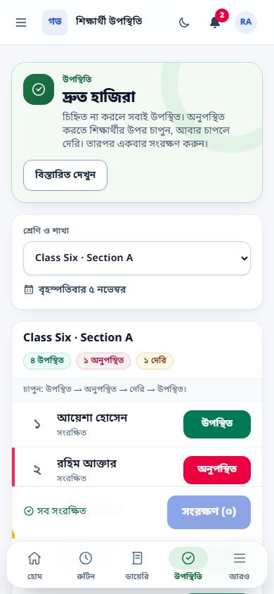

1. **শ্রেণি ও শাখা** বেছে নিন। পরের বার এটি মনে রাখা হয়।
2. চিহ্নিত না করলে সবাই উপস্থিত। কোনো শিক্ষার্থীর ওপর একবার চাপলে **অনুপস্থিত**, আবার চাপলে **দেরি**, আরেকবার চাপলে আবার **উপস্থিত**।
3. ওপরে উপস্থিত, অনুপস্থিত ও দেরির সংখ্যা দেখায়। শেষে একবার **সংরক্ষণ** চাপুন।
4. সংরক্ষণ না হওয়া পরিবর্তন থাকলে তা পরিষ্কার দেখায়। একই সময়ে অন্য কেউ একই শাখার হাজিরা বদলালে তাঁর পরিবর্তন মুছে যায় না।

### ৩.২ নম্বর প্রদান

**শিক্ষা কার্যক্রম → নম্বর প্রদান** পাতায় **আমার নম্বরপত্র** তালিকা থাকে: প্রতিটি বিষয় ও শাখার জন্য একটি করে।

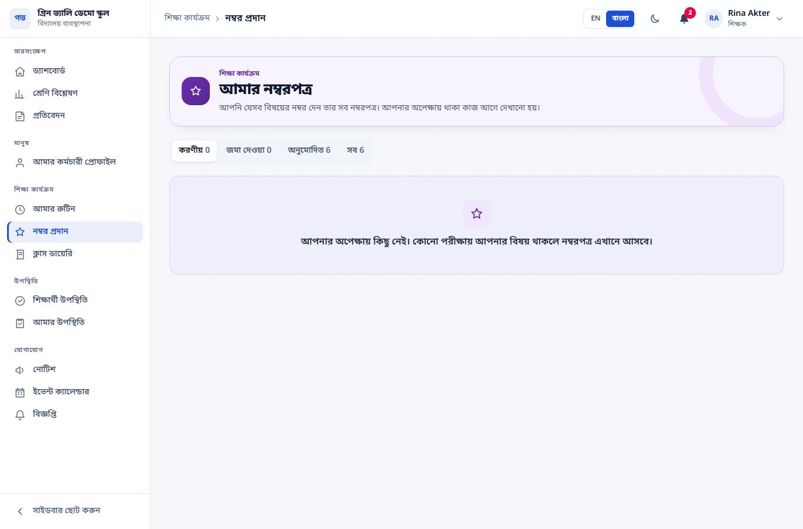

1. **নম্বরপত্র খুলুন** চাপুন।
2. **নম্বর দিন।** কিবোর্ডে Enter বা তীরচিহ্ন দিয়ে এক ঘর থেকে আরেক ঘরে যাওয়া যায়।
   - **সংরক্ষণ নিজে থেকে হয়।** আলাদা "সংরক্ষণ" বোতাম নেই; ওপরে লেখা থাকে সংরক্ষণ হচ্ছে, সব সংরক্ষিত, নাকি অফলাইন।
   - **সংযোগ না থাকলে** পরিবর্তন রাখা থাকে, আর সংযোগ ফিরলে সংরক্ষণ হয়।
   - **Excel বা Google Sheets থেকে পেস্ট** করা যায়। প্রথম কলামে ভর্তি নম্বর থাকলে সারির ক্রম যা-ই হোক, প্রতিটি নম্বর ঠিক শিক্ষার্থীর ঘরে বসে। সংরক্ষণের আগে কোন সারি বাদ পড়ল আর কেন, তা দেখায়।
3. **অনুপস্থিত বা অসম্পূর্ণ:** পরীক্ষা না দিলে **অনুপস্থিত** (Absent) দিন। খাতা হারানোর মতো কারণে **অসম্পূর্ণ** (Incomplete) দিন; সেটি মীমাংসা না হওয়া পর্যন্ত ফলাফল প্রকাশ হয় না।
4. সবার নম্বর বা অবস্থা দেওয়া হলে **পর্যালোচনার জন্য জমা দিন**। জমার পর পত্রটি আপনার জন্য শুধু দেখার; প্রধান শিক্ষক ফেরত পাঠালে কারণসহ আবার খোলে।

শেয়ার করা কম্পিউটারে সাইন আউট করলে সংরক্ষণ না হওয়া কোনো নম্বর ব্রাউজারে থেকে যায় না।

### ৩.৩ অন্যান্য

- **ক্লাস ডায়েরি:** দিনের পাঠ ও বাড়ির কাজ লিখুন। শিক্ষার্থী ও পরিবার নিজের অ্যাকাউন্টে দেখতে পায়।
- **আমার রুটিন:** সাপ্তাহিক ক্লাস রুটিন।
- **শ্রেণি বিশ্লেষণ:** নিজের শ্রেণির উপস্থিতি ও ফলাফলের চিত্র।
- **আমার উপস্থিতি** ও **আমার কর্মচারী প্রোফাইল:** নিজের হাজিরা, আর নিজের ছবি, যোগ্যতা ও কোন তথ্য কারা দেখবে তা ঠিক করা।
- **নোটিশ**, **ইভেন্ট ক্যালেন্ডার** ও **বিজ্ঞপ্তি**।

---

## অধ্যায় ৪: হিসাবরক্ষক (Accountant)

হিসাবরক্ষক **অর্থ → ফি ও হিসাব** পাতায় কাজ করেন। এখানে পাঁচটি ট্যাব: **ফি আদায়**, **বকেয়া**, **ফি নির্ধারণ**, **প্রতিবেদন** ও **আয় ও ব্যয়**।

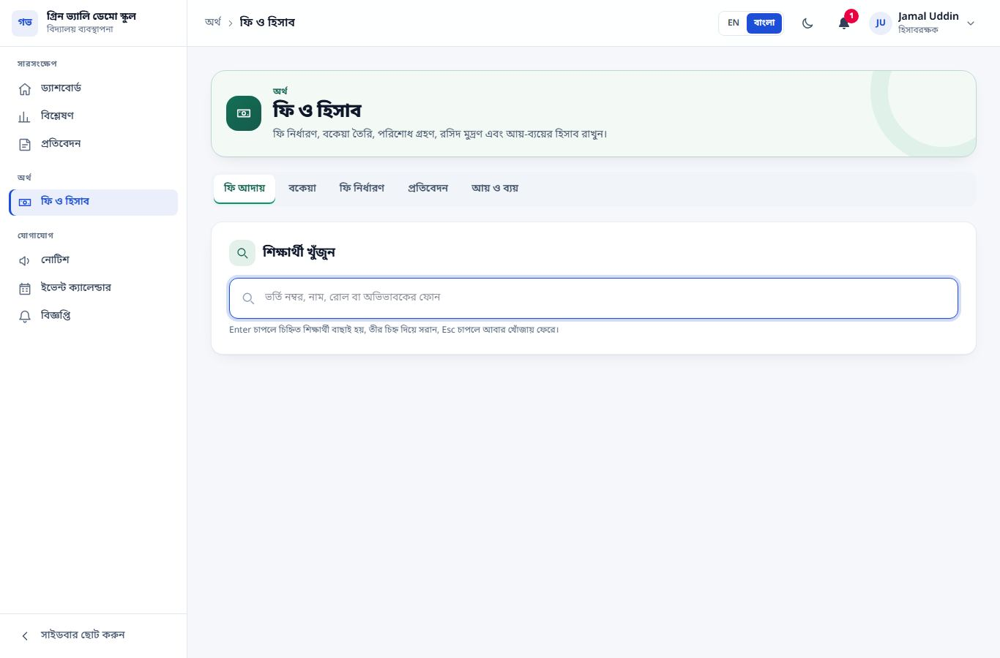

### ৪.১ ফি নির্ধারণ (বছরের শুরুতে)

1. **ফির ধরন:** যেমন বেতন, ভর্তি ফি, পরীক্ষার ফি।
2. **ফি কাঠামো:** কোন শ্রেণির কোন ফি কত টাকা।
3. **মাসিক বকেয়া তৈরি:** মাস বেছে **তৈরি করুন** চাপুন। প্রতিটি সক্রিয় শিক্ষার্থী ও সক্রিয় ফির জন্য একটি করে বকেয়া তৈরি হয়। আবার চালালে আগে থেকে থাকা বকেয়া বাদ যায়, তাই দুবার চাপলেও সমস্যা নেই।

### ৪.২ ফি আদায় (কাউন্টারে)

1. **ফি আদায়** ট্যাবে **শিক্ষার্থী খুঁজুন**: ভর্তি নম্বর, নাম, রোল বা অভিভাবকের ফোন দিয়ে। Enter চাপলে চিহ্নিত শিক্ষার্থী বাছাই হয়, তীরচিহ্ন দিয়ে সরানো যায়, আর Esc চাপলে আবার খোঁজায় ফেরা যায়।
2. বকেয়াগুলো পুরোনো থেকে নতুন ক্রমে মোটসহ দেখায়। পুরো বা আংশিক টাকা নিতে পারবেন।
3. **পদ্ধতি বেছে নিন:** নগদ, অথবা bKash, Nagad বা ব্যাংকের রেফারেন্স। টাকা আসলেই এসেছে কিনা নিজে যাচাই করে তবেই রেকর্ড করুন।
4. **আদায় করে রসিদ দিন** চাপুন, তারপর **রসিদ মুদ্রণ**। রসিদে শিক্ষার্থীর নাম ইংরেজি ও বাংলায়, আর টাকার পরিমাণ কথায় দুই ভাষায় থাকে।

ভুল করে দুবার চাপলেও একই আদায় দুবার রেকর্ড হয় না।

### ৪.৩ বকেয়া, প্রতিবেদন ও আয়-ব্যয়

- **বকেয়া:** কার কত বাকি, শ্রেণি বা শাখা অনুযায়ী।
- **প্রতিবেদন:** ফি আদায় প্রতিবেদন, তারিখ ও পদ্ধতি অনুযায়ী।
- **আয় ও ব্যয়:** স্কুলের অন্যান্য আয় ও খরচের হিসাব।
- **বিশ্লেষণ** পাতায় ফি আদায়ের চিত্র আর **প্রতিবেদন** পাতায় ছাপার উপযোগী প্রতিবেদন।

অনলাইন bKash বা Nagad পেমেন্ট এই সংস্করণে বন্ধ। পরিবার অ্যাপ থেকে টাকা দিতে পারে না; কাউন্টারে নেওয়া পেমেন্টই আসল রেকর্ড।

---

## অধ্যায় ৫: শিক্ষার্থী ও পরিবার (Student and Family)

শিক্ষার্থী আর তার পরিবার একই লগইন ব্যবহার করে: লগইন স্লিপের **সাইন-ইন আইডি** আর প্রথমবারের পর নিজের বেছে নেওয়া পাসওয়ার্ড। অভিভাবকের জন্য আলাদা লগইন লাগে না।

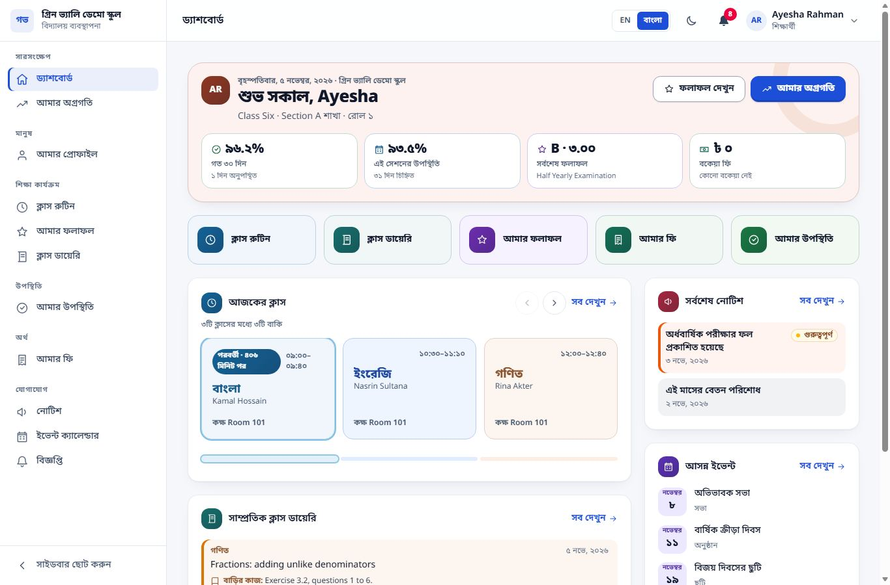

**প্রথমবার:**
1. স্লিপে লেখা ঠিকানাটি খুলুন।
2. **ইমেইল বা স্টুডেন্ট আইডি** ঘরে সাইন-ইন আইডি দিন, আর অস্থায়ী পাসওয়ার্ড দিন।
3. **নিজের পাসওয়ার্ড বেছে নিন** পাতায় নতুন পাসওয়ার্ড দিন (১২ থেকে ৭২ অক্ষর)। শুধু আপনি জানেন এমন পাসওয়ার্ড দিন।
4. স্লিপের **এই পাসওয়ার্ড ব্যবহারের শেষ তারিখের** আগেই এটি করুন। তারিখ পার হলে বিদ্যালয়ের অফিস থেকে নতুন স্লিপ নিন।

**যা দেখা যায়:**
- **আমার ফলাফল:** প্রকাশিত ফলাফল ও জিপিএ। **ফলাফল পত্র দেখুন** চাপলে বিস্তারিত দেখায়, আর **ফলাফল পত্র প্রিন্ট** দিয়ে প্রিন্ট করা যায়। PDF লাগলে প্রিন্টের ঘরে "Save as PDF" বেছে নিন। স্থগিত ফলাফলের জায়গায় অফিসে যোগাযোগ করতে বলা থাকে।
- **আমার উপস্থিতি:** দৈনিক হাজিরা।
- **আমার ফি:** বকেয়া, আগের পেমেন্ট ও রসিদ।
- **ক্লাস রুটিন** ও **ক্লাস ডায়েরি:** রুটিন, দিনের পাঠ ও বাড়ির কাজ।
- **আমার অগ্রগতি:** সময়ের সঙ্গে ফলাফল ও উপস্থিতির চিত্র।
- **আমার প্রোফাইল**, **নোটিশ**, **ইভেন্ট ক্যালেন্ডার** ও **বিজ্ঞপ্তি**।

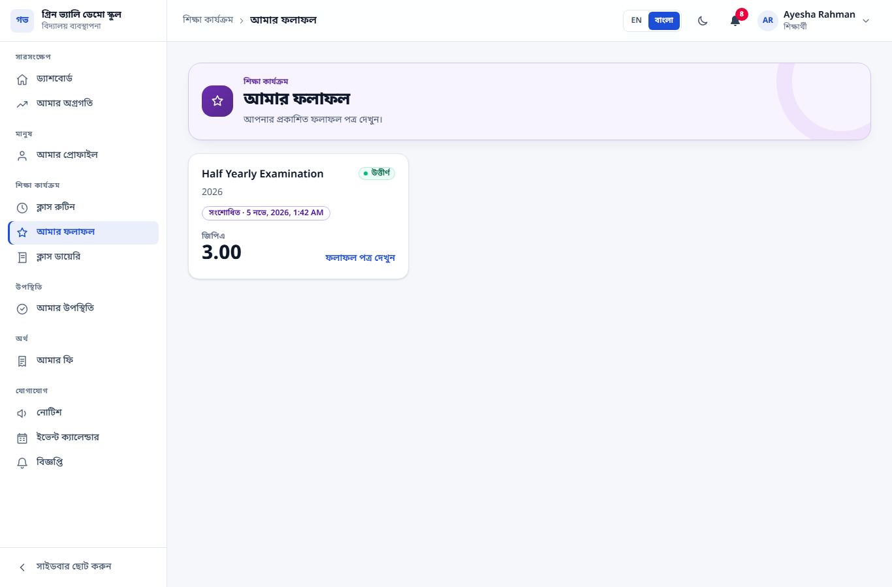

পাসওয়ার্ড ভুলে গেলে বা অ্যাকাউন্ট বন্ধ হলে বিদ্যালয়ের অফিসে যোগাযোগ করুন। কেউ ফোন বা মেসেজে পাসওয়ার্ড চাইলে দেবেন না; বিদ্যালয় কখনো তা চায় না।

---

## যা এখনো নেই

- **SMS:** এসএমএস পরীক্ষামূলক (Mock) ব্যবস্থায় চলে, কোনো ফোনে পৌঁছায় না। অ্যাপের ভেতরের বিজ্ঞপ্তি ঠিকমতো কাজ করে।
- **অনলাইন পেমেন্ট:** bKash বা Nagad দিয়ে অনলাইনে টাকা দেওয়া বন্ধ।
- **ফলাফলের আলাদা PDF ফাইল** সার্ভার থেকে তৈরি হয় না। ফলাফল পত্র ব্রাউজার থেকে প্রিন্ট করুন বা PDF হিসেবে সংরক্ষণ করুন।
- **নিজে নিজে পাসওয়ার্ড রিসেট** করা যায় না। পাসওয়ার্ড ভুলে গেলে বিদ্যালয়ের অফিস রিসেট করে।
