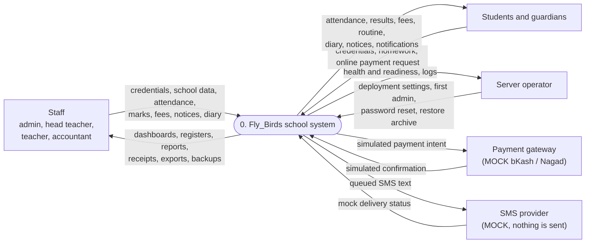
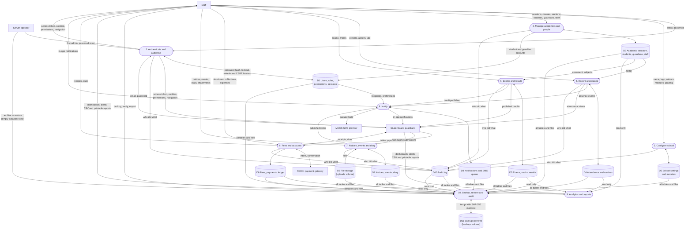

# Data Flow Diagram

Notation: rectangles are external entities, rounded boxes are processes,
cylinders are data stores. Arrows carry the data named on them.

Every request from the browser passes through the school's TLS edge and the
web server (nginx) to the Go API, which checks the session, permission and
module before any process touches a data store. Each school has its own
stack, so no data flows between schools.

## Level 0 — Context

## Level 1 — Main processes

## Notes

- **Access control (process 1)** runs before every other process: the API
  validates the 15-minute access token, checks the permission in
  `role_permissions` and the school's enabled modules, and records denied
  attempts in the audit log.
- **Scope rules:** teachers reach only the classes and subjects assigned to
  them; students only their own records; guardians only their linked
  children.
- **Simulations:** the payment gateway and the SMS provider are mocks.
  Payments are marked confirmed by the mock and SMS messages are marked
  sent without leaving the server. Neither is a live integration.
- **Restore** (process 10) refuses a database that already has users unless
  the operator explicitly forces it; see [OPERATIONS.md](../OPERATIONS.md).
