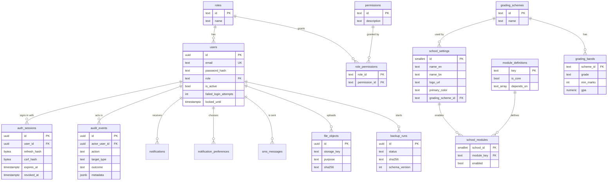
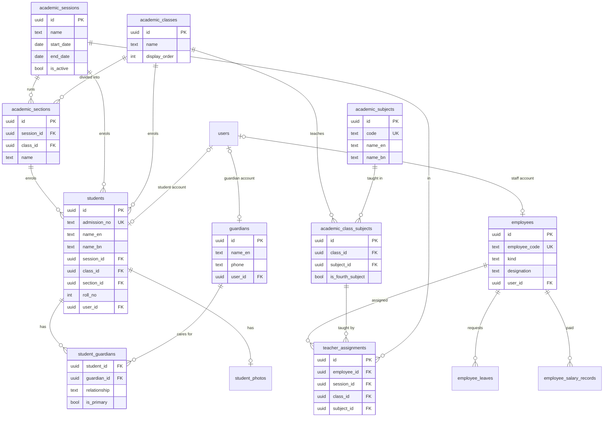
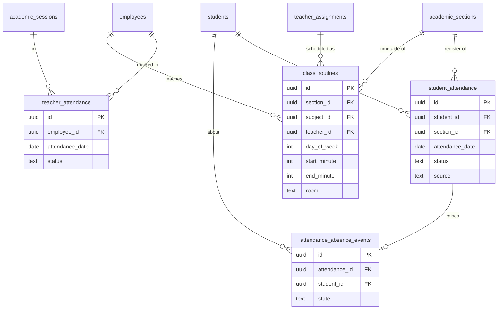
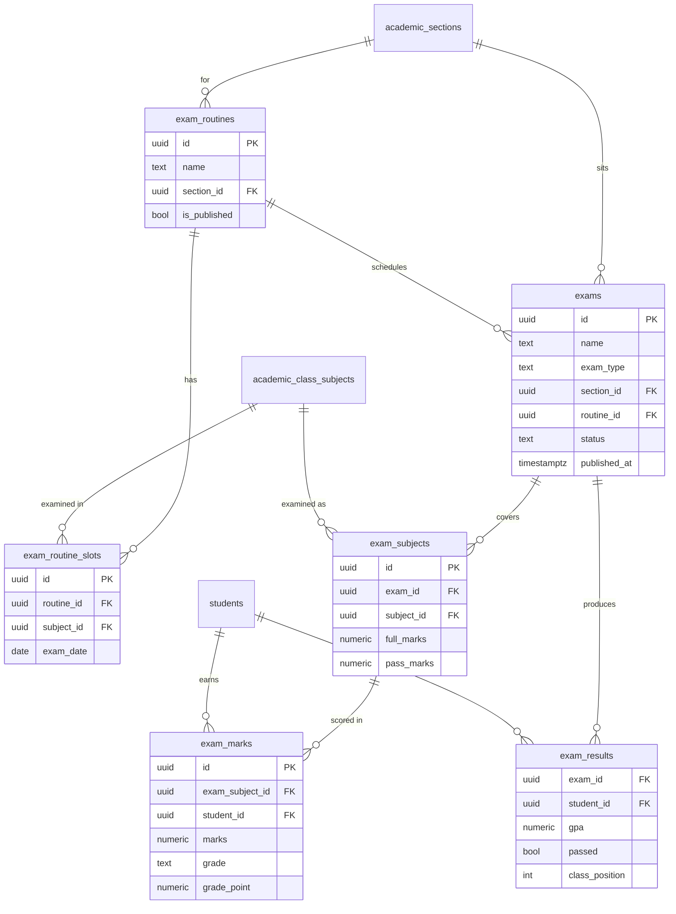
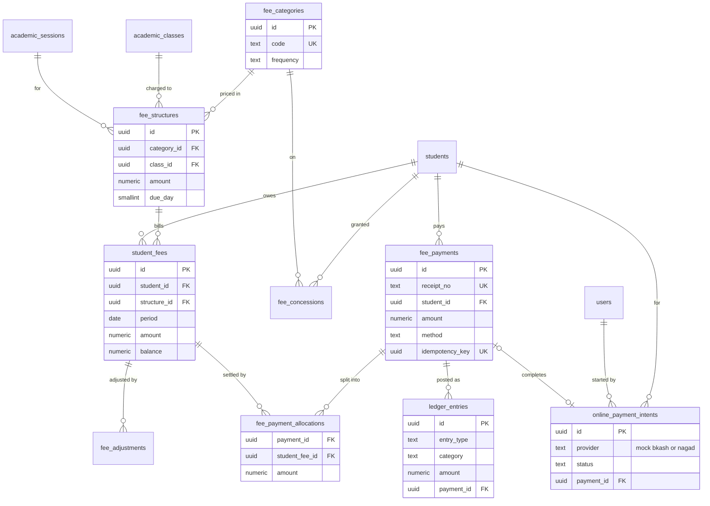
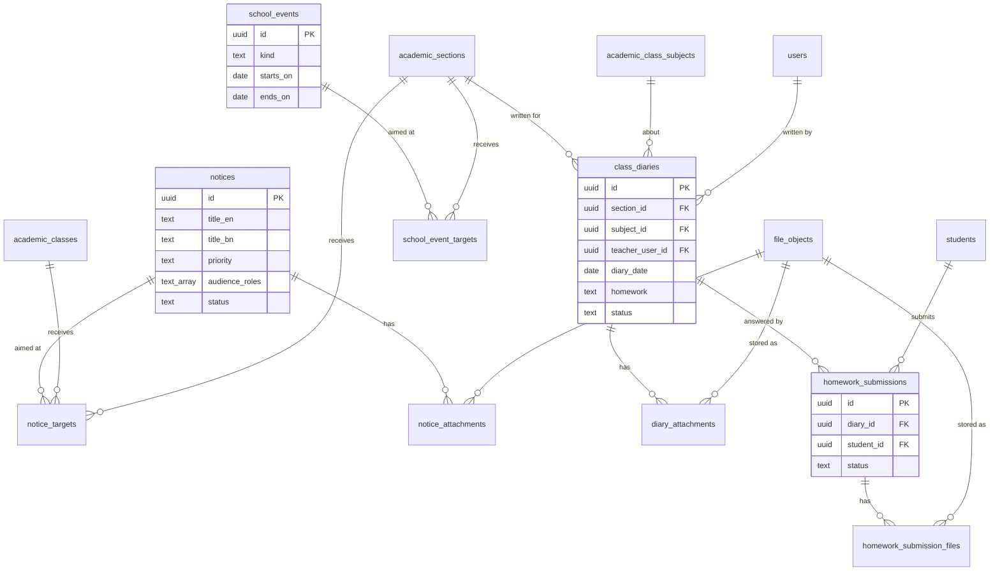

# Entity-Relationship Diagram

Generated from the migrated PostgreSQL schema (migration `1201`, 61 tables)
by reading its foreign keys. Each school runs its own database, so there is
no `school_id` column: one database holds exactly one school.

The diagram is split by domain so each part stays readable. To keep the lines
meaningful, it leaves out the `created_by`, `updated_by`, `recorded_by`,
`entered_by` and `reviewed_by` references to `users`, which almost every
business table carries for accountability. `schema_migrations` and
`demo_records` (bookkeeping for the migration runner and the demo seed) have
no relationships.

Notation: `||--o{` is one to zero-or-more; `|o--o|` is zero-or-one to
zero-or-one. Composite foreign keys (for example a student's section must
belong to the student's session and class) appear as one relationship.

## 1. Identity, access and school settings

## 2. Academic structure, people and staff

## 3. Attendance and routines

## 4. Exams and results

## 5. Fees and accounts

## 6. Notices, events and class diary

Singleton settings tables `analytics_settings` and `diary_settings` hold one
row each and reference only the user who last changed them.
