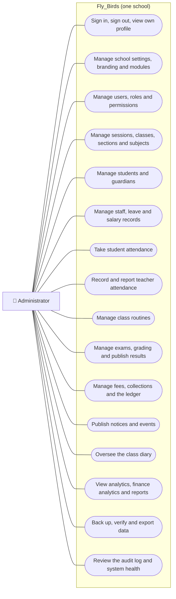
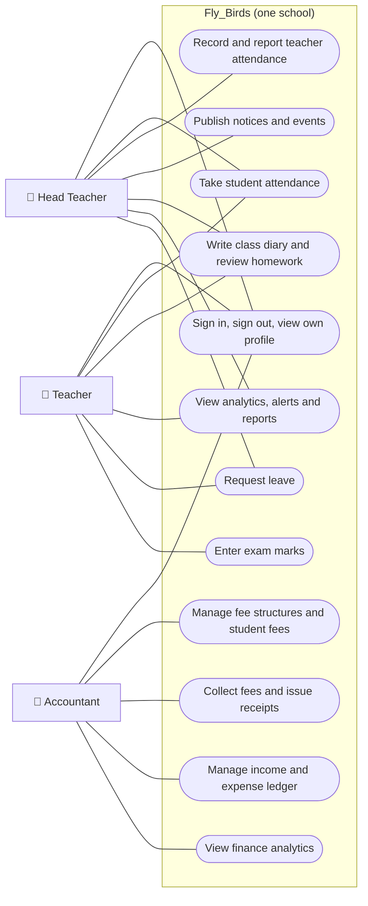
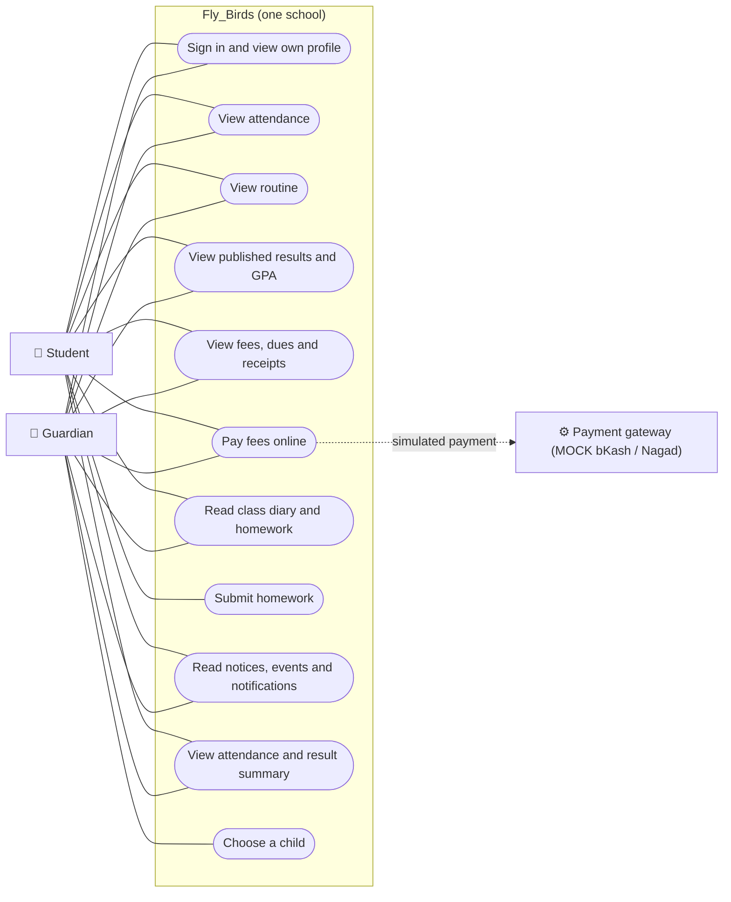
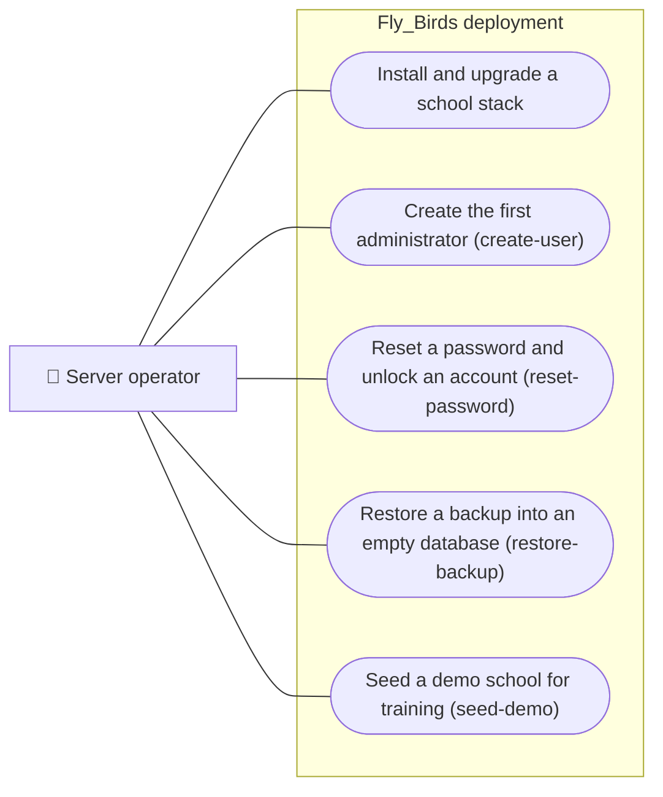

# Use Case Diagram

Actors and use cases come from the role-permission matrix the API enforces
(`role_permissions`, seeded by the migrations). Each permission is checked on
every request, and a use case also requires its module to be enabled for the
school. Mermaid has no native UML use-case notation, so actors are drawn as
boxes and use cases as rounded ovals inside the system boundary.

## Administrator

## Head teacher, teacher and accountant

Notes:
- The head teacher reads (but does not change) academic structure, students,
  guardians, staff, routines and exams.
- A teacher's analytics, attendance and marks entry are limited to the
  classes and subjects assigned to them.
- The administrator also manages the class diary (`diary:manage`), for
  example reviewing every teacher's entries.

## Students and guardians

Students see only their own records; guardians see only the children linked
to them. Online payment goes through a **mock** provider: no real bKash or
Nagad account is charged until a real gateway is integrated.

## Operator (server command line)

See [OPERATIONS.md](../OPERATIONS.md) for each operator procedure.
